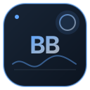
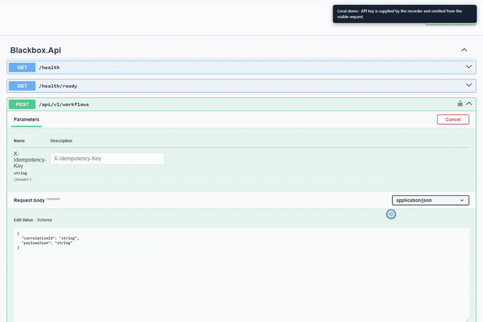

  

<h1 align="center">Blackbox</h1>

<strong>.NET 10 distributed-order processing with PostgreSQL, Kafka, and a transactional outbox.</strong>

   

 

**Stack:** C# · .NET 10 · ASP.NET Core · PostgreSQL · Kafka · Docker Compose · xUnit · Playwright

<a href="#run-locally">Run locally</a> &nbsp;·&nbsp; <a href="#recorded-demo">Recorded demo</a> &nbsp;·&nbsp; <a href="#license">License</a>

## Overview

Blackbox explores order processing across an HTTP API, PostgreSQL, Kafka, a background worker, and an in-process carrier failure simulator. Its central engineering question is how to keep workflow state and event publication consistent across failures and retries. The carrier path does not call a real third-party API.

This repository is an active portfolio prototype, not production software. On 2026-10-15 the current worktree passed a Release build with zero warnings, all 71 unit tests, and all 14 PostgreSQL Testcontainers tests. A previously recorded isolated Compose smoke test created a workflow, observed its live Kafka Inbox receipt and projection, republished the event at a new Kafka offset, and confirmed both remained at one. It also verified that a changed payload with the same EventId and malformed JSON were quarantined, with both EF migrations applied. The final poison-message deduplication refinement is covered by the current PostgreSQL tests; the Compose smoke test was not repeated after that adjustment. This does not simulate a worker crash between database commit and offset commit. GitHub Actions run [#11](https://github.com/Mr444-dev/blackbox/actions/runs/38799910247) on this commit failed before any steps were recorded; its log endpoint returned `BlobNotFound`, and the Compose job was skipped. Remote CI is unresolved. The earlier 32/32 Playwright audit predates this change. See [Engineering Status](ENGINEERING_STATUS.md) for evidence and remaining limits.

## Recorded demo

[Watch the full workflow demo (WebM)](docs/media/blackbox-workflow-demo.webm). The recording shows the Development Swagger UI creating a workflow, reading it back, reserving inventory, and completing it against the local API and PostgreSQL-backed stack. The API key is supplied to the recorder at runtime and is not included in the video.

The walkthrough pauses before each important click, keeps a highlighted pointer visible, and briefly uses a pointer spotlight that can be toggled with two Ctrl taps. Red arrows and target rings identify the current control. Eight numbered screenshots are included below and regenerated alongside the video.

Each recording run creates a new workflow and reserves one `SKU-DESK-003` unit in the local development database. The completed workflow and reservation remain stored, so use disposable demo data when re-recording. The API key is injected by the recorder and is never written into the screenshots or video.

View the walkthrough step by step

