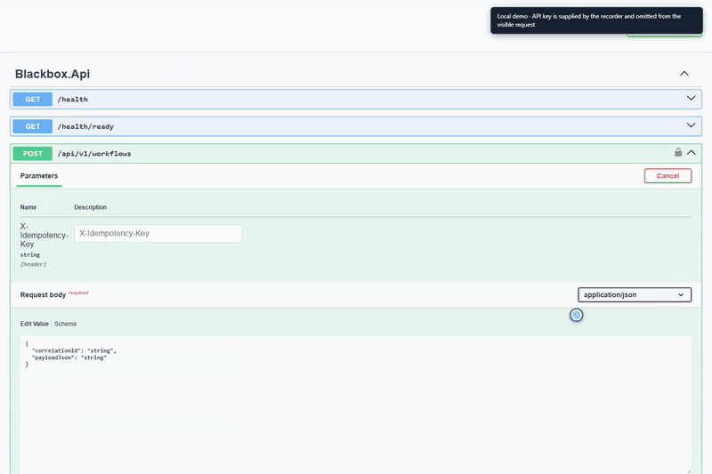
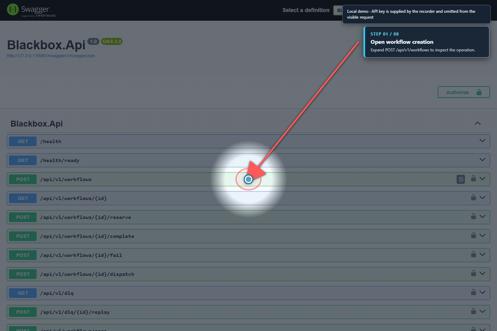
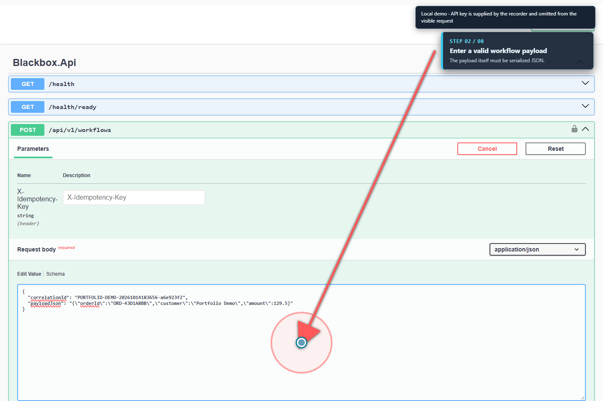
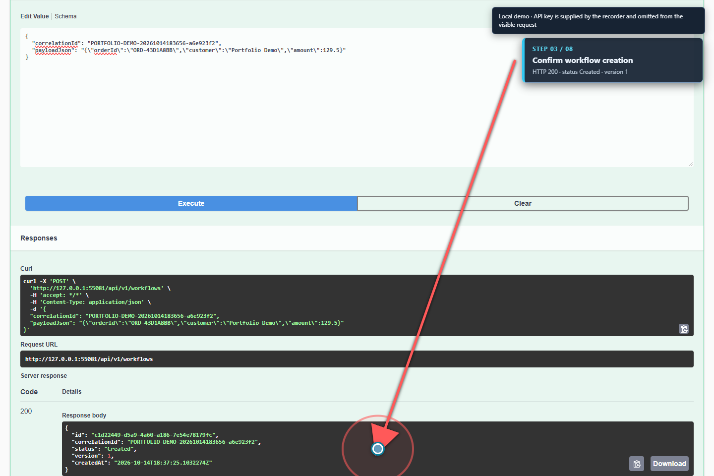
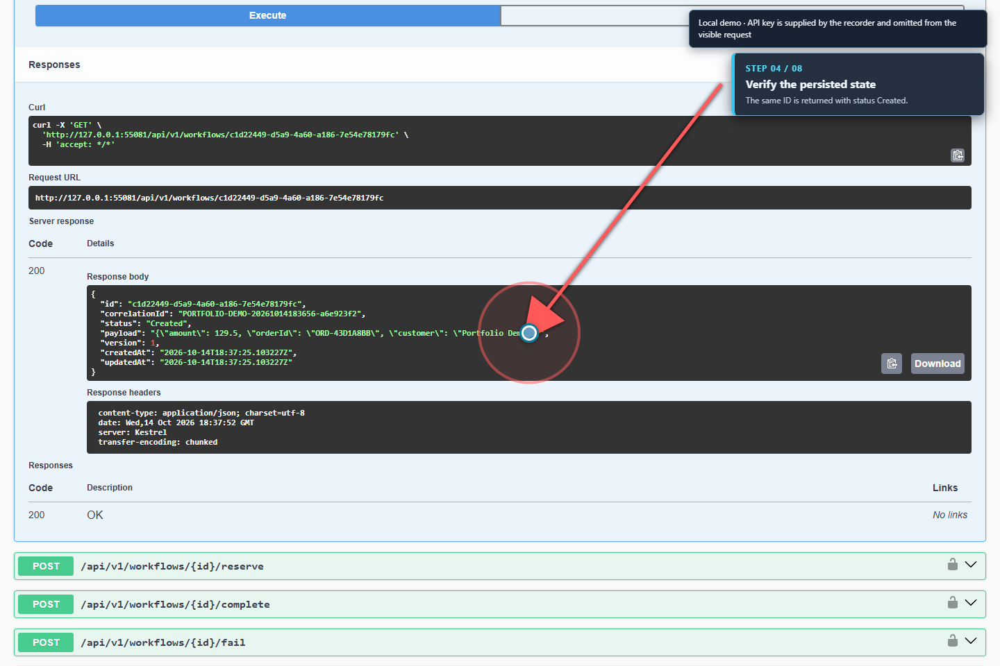
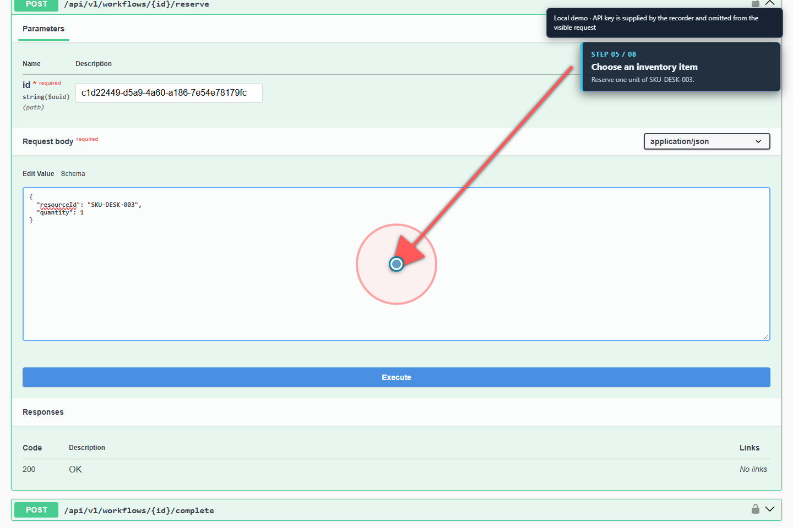
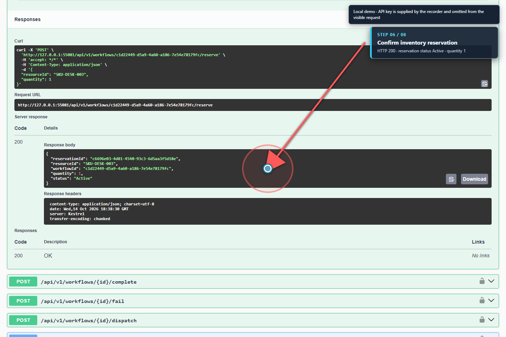
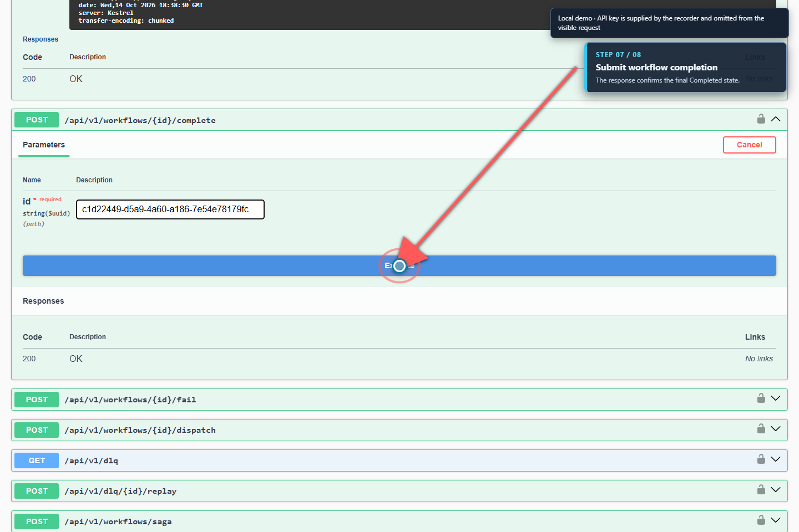
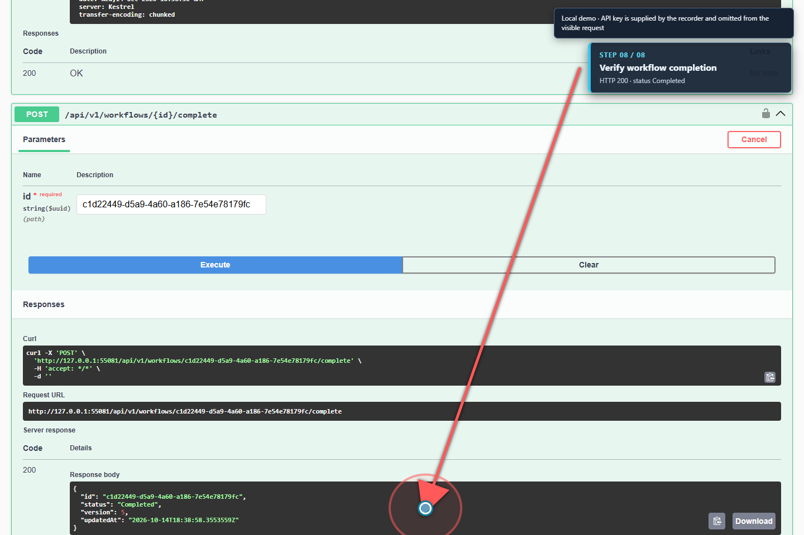

<p align="center">
  
</p>

<h1 align="center">Blackbox</h1>

<p align="center"><strong>.NET 10 distributed-order processing with PostgreSQL, Kafka, and a transactional outbox.</strong></p>

<p align="center">   </p>

<p align="center"></p>

**Stack:** C# · .NET 10 · ASP.NET Core · PostgreSQL · Kafka · Docker Compose · xUnit · Playwright

<p align="center"><a href="#run-locally">Run locally</a> &nbsp;·&nbsp; <a href="#recorded-demo">Recorded demo</a> &nbsp;·&nbsp; <a href="#license">License</a></p>

## Overview

Blackbox explores order processing across an HTTP API, PostgreSQL, Kafka, a background worker, and an in-process carrier failure simulator. Its central engineering question is how to keep workflow state and event publication consistent across failures and retries. The carrier path does not call a real third-party API.

This repository is an active portfolio prototype, not production software. On 2026-10-15 the current worktree passed a Release build with zero warnings, all 71 unit tests, and all 14 PostgreSQL Testcontainers tests. A previously recorded isolated Compose smoke test created a workflow, observed its live Kafka Inbox receipt and projection, republished the event at a new Kafka offset, and confirmed both remained at one. It also verified that a changed payload with the same EventId and malformed JSON were quarantined, with both EF migrations applied. The final poison-message deduplication refinement is covered by the current PostgreSQL tests; the Compose smoke test was not repeated after that adjustment. This does not simulate a worker crash between database commit and offset commit. GitHub Actions run [#11](https://github.com/Mr444-dev/blackbox/actions/runs/38799910247) on this commit failed before any steps were recorded; its log endpoint returned `BlobNotFound`, and the Compose job was skipped. Remote CI is unresolved. The earlier 32/32 Playwright audit predates this change. See [Engineering Status](ENGINEERING_STATUS.md) for evidence and remaining limits.

## Recorded demo

<p align="center"><a href="docs/media/blackbox-workflow-demo.webm"></a></p>

[Watch the full workflow demo (WebM)](docs/media/blackbox-workflow-demo.webm). The recording shows the Development Swagger UI creating a workflow, reading it back, reserving inventory, and completing it against the local API and PostgreSQL-backed stack. The API key is supplied to the recorder at runtime and is not included in the video.

The walkthrough pauses before each important click, keeps a highlighted pointer visible, and briefly uses a pointer spotlight that can be toggled with two Ctrl taps. Red arrows and target rings identify the current control. Eight numbered screenshots are included below and regenerated alongside the video.

Each recording run creates a new workflow and reserves one `SKU-DESK-003` unit in the local development database. The completed workflow and reservation remain stored, so use disposable demo data when re-recording. The API key is injected by the recorder and is never written into the screenshots or video.

<details>
<summary>View the walkthrough step by step</summary>

| Step | Screenshot |
| :--- | :--- |
| 1. Open workflow creation |  |
| 2. Enter a valid workflow request |  |
| 3. Create the workflow |  |
| 4. Read back the persisted workflow |  |
| 5. Prepare the inventory reservation |  |
| 6. Confirm the reservation |  |
| 7. Prepare workflow completion |  |
| 8. Confirm completion |  |

</details>

To record it again, start the local stack, install the Playwright dependency, and run the script from the repository root. It reads `BLACKBOX_API_KEY` from the process environment or the Git-ignored `.env` file and requires the API readiness endpoint to pass. The script uses Brave when available at its default Windows path and otherwise uses Playwright-managed Chromium. The on-screen note explains why the key is absent from the visible request example.

```powershell
npm ci --prefix tests/blackbox-e2e
node scripts/record-demo.mjs
```

The script writes the WebM recording, a PNG poster, and eight annotated PNG screenshots. The short animated GIF is an excerpt; refresh it after a new recording with the FFmpeg command below. Set `BLACKBOX_BRAVE_PATH` if Brave is installed somewhere other than its default Windows location.

On a machine without Brave, install the Playwright browser once with `npm --prefix tests/blackbox-e2e exec -- playwright install chromium`.

If you re-record the video, refresh the animated README preview with FFmpeg:

```bash
ffmpeg -y -ss 15 -i docs/media/blackbox-workflow-demo.webm -t 18 -vf "fps=3,scale=800:-1:flags=lanczos,split[s0][s1];[s0]palettegen=max_colors=96[p];[s1][p]paletteuse=dither=bayer:bayer_scale=3" -loop 0 docs/media/blackbox-workflow-demo.gif
```

## Why this project exists

Directly publishing a broker message after a database write creates a failure window: one side can succeed while the other fails. Blackbox demonstrates the transactional-outbox pattern and makes its delivery semantics and duplicate-handling boundaries explicit.

## Engineering Highlights

- **Transactional Outbox:** workflow state and its event are saved in one PostgreSQL transaction; a worker publishes pending records through Kafka.
- **At-least-once delivery:** worker locks prevent two workers from publishing the same row concurrently. A crash after broker acknowledgement can still produce a duplicate, which consumers must handle.
- **Transactional Inbox projection:** domain-event `EventId` values are stable in the serialized payload, so a republished event is recognized even at a different Kafka offset. PostgreSQL's unique `(consumer_name, message_id)` index plus `ON CONFLICT DO NOTHING` makes the receipt insert safe under concurrent delivery. A new event updates a workflow-event read model in the same transaction as its receipt; duplicate events do not repeat that effect. Invalid JSON, ambiguous JSON, and EventId/content conflicts are stored in the DLQ with deduplication keys and their Kafka transport IDs before the consumer commits their offsets. The projection is not authoritative workflow state.
- **Concurrency and idempotency:** PostgreSQL row locks protect inventory reservations; unique correlation IDs make concurrent duplicate create requests converge on one workflow.
- **Bounded failure handling:** the Outbox retries publish failures and creates a DLQ record after five attempts.
- **Explicit DLQ replay boundary:** only carrier simulator records can be replayed today. Kafka Outbox and Inbox quarantine records are durable but do not have an operator-controlled replay endpoint; Kafka Outbox replay returns `501` instead of falsely reporting the event as replayed.
- **API access:** application routes require `X-API-Key` with at least 32 UTF-8 bytes; liveness and database readiness endpoints are public.
- **Development API docs:** Swagger UI is available without an API key in Development and exposes an `Authorize` control for protected routes; Swagger is disabled in Production.
- **Verification scorecard:** checks scenario evidence provided to the engine. Missing inputs are marked not evaluated; it does not claim formal verification or production SLO measurements.
- **Rule-based remediation prototype:** classifies example incidents and suggests actions. It does not execute the proposed remediation.
- **Automated checks:** xUnit unit tests, PostgreSQL Testcontainers tests, and Playwright API scenarios.

Other modules explore saga compensation, contract drift, CRDTs, Merkle inclusion proofs, and observability. They have different levels of maturity and are not all connected to durable, multi-node workflows. Their current boundaries are documented in [Engineering Status](ENGINEERING_STATUS.md).

Experimental in-memory, scenario-evaluation, AI recommendation, and cryptography endpoints are mapped only in the Development environment. The signature and KEM are educational toy examples, not ML-DSA or ML-KEM, not FIPS compliant, and must never be used for security. See [the crypto demo limitations](docs/architecture/POST_QUANTUM_CRYPTOGRAPHY.md).

## Architecture

```text
Client --X-API-Key--> ASP.NET Core API
                         |
                         | one PostgreSQL transaction
                         v
                 workflow + outbox
                         |
                         v
              Outbox worker --publish--> Kafka
                                             |
                                             v
                                  Inbox consumer
                                             |
                      one PostgreSQL transaction
                              /              \\
                             v                v
                     Inbox receipt    workflow-event projection
```

PostgreSQL is the source of truth for workflow state and Outbox/Inbox records. Kafka delivery is **at least once**. The Outbox row lock prevents concurrent workers from publishing the same row at the same time. If publish succeeds and the database transaction then fails, the event can be published again after recovery. For domain-event JSON, the Inbox uses the stable `EventId` instead of broker coordinates, so the same event is deduplicated after republication at a new offset. A newly accepted domain event updates `workflow_event_projections` atomically with its Inbox receipt; the projection summarizes event traffic and does not replace the authoritative workflow row. Valid JSON without a usable domain `EventId` is stored as a transport-keyed receipt and does not update that projection. Invalid JSON and same-ID/different-content deliveries are quarantined durably before the consumer commits those offsets. The consumer group is `blackbox-inbox-v2` because it now uses a different message identity; with no existing v2 offsets, it starts at the earliest retained message and records that history under the new consumer name. Containers connect to Kafka at `kafka:9092`; host tools can connect through `localhost:29092` (or the configured `BLACKBOX_KAFKA_HOST_PORT`). Host tools can connect to PostgreSQL on `localhost:15432` by default; containers use `postgres:5432`.

## Example API flow

1. `POST /api/v1/workflows` with `X-API-Key` and `X-Idempotency-Key` creates the workflow and Outbox event atomically.
2. `POST /api/v1/workflows/{id}/reserve` reserves stock under a PostgreSQL row lock.
3. Compose creates the `blackbox.workflow.events` and `blackbox.resource.events` Kafka topics. The worker publishes Outbox events, records Inbox receipts keyed by stable `EventId`, and updates the workflow-event projection in the same PostgreSQL transaction.
4. `POST /api/v1/workflows/{id}/complete` advances the workflow state machine.


### Redelivery demo (same EventId, new Kafka offset)

After creating a workflow through the API and waiting for the worker to log `Recorded Kafka event`, republish the exact persisted `WorkflowCreated.v1` payload as a new Kafka record. The command prints the payload first; note its `EventId` for the verification query below:

```bash
event_json="$(docker compose exec -T postgres psql -U blackbox_user -d blackbox_db -Atc "SELECT payload::text FROM outbox_messages WHERE event_type = 'WorkflowCreated.v1' ORDER BY created_at DESC LIMIT 1")"
printf '%s\n' "$event_json"
printf '%s\n' "$event_json" | docker compose exec -T kafka /opt/kafka/bin/kafka-console-producer.sh --bootstrap-server kafka:9092 --topic blackbox.workflow.events
```

The worker should log `Skipping duplicate Kafka delivery`. Replace `<EventId>` with the ID from the payload above and verify the stored receipt:

```sql
SELECT message_id, COUNT(*) AS receipts
FROM inbox_messages
WHERE consumer_name = 'blackbox-inbox-v2'
  AND message_id = '<EventId>'
GROUP BY message_id;
```

The result should contain one receipt. Verify the projection effect remained single as well:

```sql
SELECT workflow_id, event_count, last_event_id, last_event_type
FROM workflow_event_projections
WHERE last_event_id = '<EventId>';
```

The sequential PostgreSQL integration test models a worker restart between DB commit and Kafka offset commit with a fresh DbContext; it does not restart a live Kafka worker. Concurrent-delivery, out-of-order events, mismatched-payload, duplicate-property, poison-JSON, migration, and schema-adoption tests cover the related database behavior, including preservation of a pre-existing workflow during schema adoption. Poison-message quarantine deduplicates retries of the same consumer and Kafka offset while retaining separate records for identical payloads at different offsets. The Playwright/Compose CI job checks that a live Kafka event produces both an Inbox receipt and a projection row.

Reusing the same idempotency key with a different JSON value returns `409 Conflict`. Object key order and insignificant whitespace do not change the payload value, so a PostgreSQL `jsonb` round trip does not break retries.
Workflow payloads must contain valid JSON, must not contain a U+0000 null character (which PostgreSQL `jsonb` cannot store), and are limited to 256 KiB; invalid JSON receives `400 Bad Request` and oversized payloads receive `413 Payload Too Large`.

See the endpoint handlers in [`src/Blackbox.Api/Program.cs`](src/Blackbox.Api/Program.cs) and the orchestration logic in [`WorkflowOrchestrator.cs`](src/Blackbox.Infrastructure/Services/WorkflowOrchestrator.cs).

## My Contribution

This repository contains the implementation of the API, workflow and event-processing path, infrastructure adapters, scenario verification, automated tests, and local development setup. Experimental modules are called out separately where they are not integrated into the durable workflow.

## Key Systems

### Transactional outbox

Order state and the event to publish are written in the same PostgreSQL transaction. A separate worker claims pending rows and publishes them to Kafka. This closes the database/broker dual-write gap, while retaining at-least-once delivery semantics: consumers must tolerate a duplicate after a publish succeeds but acknowledgement state is not committed.

### Inbox receipt and workflow boundary

The consumer extracts `EventId` from domain-event JSON and inserts the receipt with PostgreSQL `ON CONFLICT DO NOTHING`. A new event also updates the event-summary projection in that transaction. A repeated event at another topic offset leaves one receipt and one projection effect, then the worker commits the duplicate offset. Payloads without a usable `EventId` use their broker coordinates as a fallback and are recorded without a workflow projection. Invalid JSON and mismatched payloads for an existing EventId go to a deduplicated DLQ entry before their offsets are committed.

### Concurrent order creation

Inventory reservation uses database locking, and a unique correlation identifier makes concurrent duplicate create requests converge. The PostgreSQL Testcontainers suite exercises five simultaneous duplicate-start requests and asserts that they produce one workflow and one Outbox record; it does not yet test concurrent inventory reservations.

## Design Decisions and Trade-offs

- PostgreSQL is the source of truth for workflow and outbox state; Kafka delivery is at least once, so duplicates remain possible and consumers need idempotency.
- The Inbox projection is a derived read model. It does not mutate or replace authoritative workflow status, and it does not make Kafka delivery exactly once.
- The API uses one shared API key for a local portfolio demo; production identity, scoped authorization, key rotation, rate limiting, and TLS are out of scope. Keys shorter than 32 UTF-8 bytes are rejected.
- Carrier outcomes are simulated in process; no partner account or API credential is required. The Polly pipeline is created by a scoped service, so breaker state is not retained across API requests. Do not treat it as a production circuit-breaker integration.
- Experimental in-memory, evaluation, AI recommendation, and cryptography endpoints are not mapped when `ASPNETCORE_ENVIRONMENT` is `Production`; the default Compose profile is `Development` so the portfolio demonstrations remain available locally.
- EF Core migrations initialize new databases. Databases previously created with `EnsureCreated` need the checked legacy-schema adoption step below before this version starts; take a verified backup first.

## Requirements

- .NET SDK 10
- Docker Desktop or Docker Engine with Compose v2
- Node.js 22 and npm, for Playwright tests

## Run locally

1. Copy `.env.example` to `.env` and replace both values with local development secrets. Generate an API key with at least 32 random bytes, for example in PowerShell 7: `[Convert]::ToBase64String([System.Security.Cryptography.RandomNumberGenerator]::GetBytes(32))`. The default host ports are API `5000`, PostgreSQL `15432`, and Kafka `29092`; change the corresponding `BLACKBOX_*_PORT` value in `.env` if a port is occupied. Process-level `BLACKBOX_*_PORT` variables override `.env`, which is useful for running an isolated stack beside another local instance.

   If this PostgreSQL volume was initialized by an earlier Blackbox version that used EF Core `EnsureCreated`, stop the old API and Worker, take a verified backup, and start only PostgreSQL before running the adoption script:

   ```powershell
   docker compose stop api worker
   docker compose up -d postgres
   Get-Content -Raw .\scripts\adopt-ensurecreated-schema.sql | docker compose exec -T postgres psql -U blackbox_user -d blackbox_db -v ON_ERROR_STOP=1
   ```

   The script checks the known legacy schema and records the baseline migration without changing application rows. It aborts if the schema differs or migration history already exists. Do not run it against a fresh or unknown database; new databases are migrated automatically.

2. Start the stack from the repository root:

   ```bash
   docker compose up --build
   ```

3. Wait until the API readiness check responds:

   ```bash
   curl http://localhost:5000/health/ready
   ```

4. Call the API using the key from `.env`:

   ```bash
   curl -X POST http://localhost:5000/api/v1/workflows \
     -H "X-API-Key: YOUR_LOCAL_KEY" \
     -H "X-Idempotency-Key: demo-order-001" \
     -H "Content-Type: application/json" \
     -d '{"payloadJson":"{\"orderId\":\"demo-order-001\"}"}'
   ```

Swagger and experimental endpoints are available only in Development. Application endpoints require `X-API-Key`. `/health` is a liveness probe; `/health/ready` checks PostgreSQL connectivity. The API fails startup if a migration or seed initialization fails. The local Compose credentials are for an isolated developer demo only.

The Compose stack creates its two Kafka topics with a one-shot `kafka-init` service. If you run the Worker against a separately managed Kafka cluster, provision `blackbox.workflow.events` and `blackbox.resource.events` before starting the Worker.

Stop the stack with `docker compose down`. Add `--volumes` only when you intentionally want to remove the local PostgreSQL data.

## Testing

```bash
dotnet test tests/Blackbox.UnitTests/Blackbox.UnitTests.csproj
dotnet test tests/Blackbox.IntegrationTests/Blackbox.IntegrationTests.csproj
```

The PostgreSQL suite includes `InboxProcessor_RedeliveredEventAtNewKafkaOffset_ShouldPersistOneReceipt`, which verifies that the same logical event delivered at a new offset creates one durable receipt.

Integration tests use Testcontainers and require a working Docker daemon. Without `BLACKBOX_TESTCONTAINERS=true`, xUnit marks them skipped by design. With the flag enabled, a missing or unreachable Docker daemon fails the test run; skipped tests are not counted as passing PostgreSQL verification.

```powershell
$env:BLACKBOX_TESTCONTAINERS = "true"
dotnet test tests/Blackbox.IntegrationTests/Blackbox.IntegrationTests.csproj
```

For the API tests, start the Compose stack first, then run:

```powershell
$env:BLACKBOX_API_KEY = "YOUR_LOCAL_KEY"
$env:BLACKBOX_API_URL = "http://localhost:5000"
cd tests/blackbox-e2e
npm ci
npx playwright install chromium
npm test
```

### Repeatable local E2E run on Windows

The Playwright scenarios use shared seed inventory, so rerunning them against a database already changed by an earlier suite can produce misleading capacity failures. Use the isolated runner to create a fresh, uniquely named Compose project and disposable PostgreSQL volume for every run:

```powershell
.\scripts\verify-local.ps1
```

The runner preserves existing non-placeholder values in the Git-ignored `.env`, generates missing local secrets, waits for API readiness, and runs the complete Playwright suite. By default it removes only the temporary project and its volume after the run. To keep the stack available for a demo or failure investigation:

```powershell
.\scripts\verify-local.ps1 -KeepStack
```

The script prints the isolated Compose project name and a matching `docker compose -p ... down` command. That command stops containers without deleting the volume.

GitHub Actions builds Release, runs the .NET tests, starts the full Compose stack, waits for readiness, runs Playwright, and checks that Outbox events reached Kafka and produced both an Inbox receipt and workflow-event projection. Failures fail the workflow.

## Documentation

- [Engineering status and verified checks](ENGINEERING_STATUS.md)
- [Architecture notes](docs/architecture/)
- [Kubernetes deployment prerequisites](deploy/k8s/README.md)
- [Terraform deployment and state handling](deploy/terraform/README.md)
- [Project direction and roadmap](docs/PROJECT_PLAN.md)
- [Chaos test plan](docs/chaos/CHAOS_ENGINEERING_LAB.md)
- [Performance lab plan](docs/benchmarks/SQL_PERFORMANCE_LAB.md)
- [Mutation testing](docs/benchmarks/MUTATION_TESTING_REPORT.md)

Architecture and lab documents distinguish implemented behavior from proposed work. Performance numbers and chaos-test outcomes are not claimed without reproducible run evidence.

## Repository map

| Path | Purpose |
|---|---|
| `src/Blackbox.Core` | Domain entities, state rules, contracts, and scenario verification |
| `src/Blackbox.Infrastructure` | EF Core persistence, resource locking, Kafka producer, outbox processing, carrier simulator |
| `src/Blackbox.Api` | HTTP API, API key authentication, liveness/readiness endpoints |
| `src/Blackbox.Worker` | Outbox publisher and Kafka Inbox consumer |
| `tests/Blackbox.UnitTests` | Fast domain/service tests |
| `tests/Blackbox.IntegrationTests` | PostgreSQL Testcontainers tests |
| `tests/blackbox-e2e` | Playwright API scenarios |
| `docker-compose.yml` | PostgreSQL, Kafka, API, and worker for local development |

## Code Tour

- [`Program.cs`](src/Blackbox.Api/Program.cs) — HTTP routes, API-key boundary, liveness, and readiness.
- [`WorkflowOrchestrator.cs`](src/Blackbox.Infrastructure/Services/WorkflowOrchestrator.cs) — workflow state transitions and transactional persistence.
- `src/Blackbox.Infrastructure/Services/OutboxProcessor.cs` — pending message publication and retry/DLQ handling.
- `tests/Blackbox.IntegrationTests/TransactionalOutboxTests.cs` — PostgreSQL-backed outbox behavior when Testcontainers are enabled.
- `tests/blackbox-e2e/specs/` — API scenarios driven by Playwright.

## Performance

The repository contains performance lab plans, but no benchmark result is claimed here until it is reproducible from the checked-in workload and environment.

## Known limitations

- EF Core migrations create and evolve the schema. The initial baseline matches the schema produced by the former `EnsureCreated` bootstrap; an existing database must pass the explicit adoption script before startup. Back up persistent data before schema changes. This remains a portfolio prototype, not a production deployment plan.
- The Inbox durably deduplicates receipts and updates a workflow-event read model in the same PostgreSQL transaction. The projection is not canonical workflow state. Local Compose verified delivery, a new-offset duplicate, a content conflict, and malformed JSON, but did not inject a worker crash between database commit and offset commit.
- Inbox poison/conflict messages are persisted in the DLQ with their Kafka transport ID. There is no operator-controlled Inbox quarantine replay API yet; the existing replay route only supports carrier simulator records.
- The Outbox retries immediately on subsequent worker polls and has a fixed five-attempt ceiling; exponential backoff and operator-controlled replay need further work.
- API key authentication is a simple portfolio example. Production deployment needs managed secrets, key rotation, scoped identities/authorization policies, rate limits, and TLS.
- CRDT and audit ledger modules are in-memory demonstrations; multiple API replicas do not share their state.
- The default Compose stack is local development, not a hardened production deployment.

## Roadmap

See [`docs/PROJECT_PLAN.md`](docs/PROJECT_PLAN.md). Next reliability milestones are failure injection around the Kafka offset commit, Outbox retry backoff, and an operator-safe Kafka DLQ replay path.

## License

MIT. See [LICENSE](LICENSE). Third-party dependencies and assets remain under their respective licenses.
